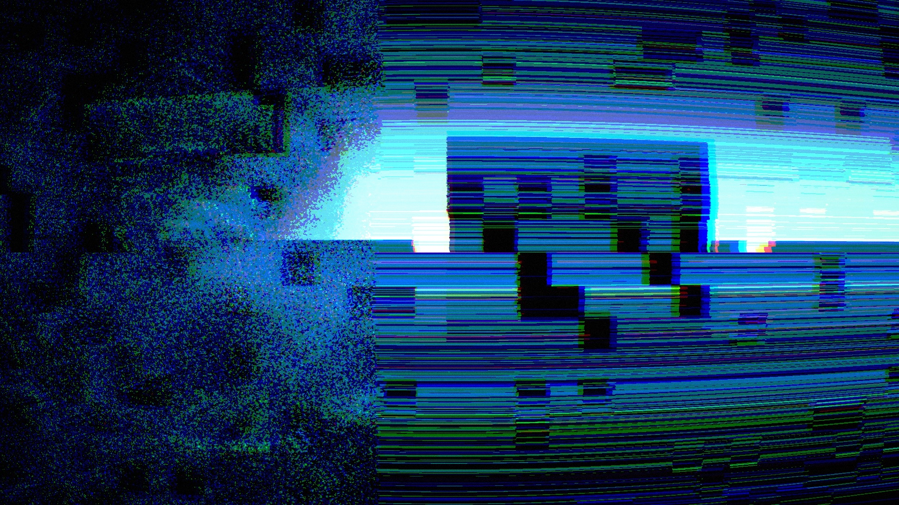

# curl-noise-audio-reactive

Audio-reactive curl-noise particles for TouchDesigner, with a panel of glitch effects.

Open `curl_noise_audio_reactive.toe` in TouchDesigner 2025.30000 or later (it uses POPs).
The track is one of the audio samples that ship with TouchDesigner; change the file on `audiofilein1` to use your own.

- Particles: about 200,000 points moved by 3D curl noise (Particle POP + Noise POP)
- Sound: the track is split into kick / bass / mid / high. Kicks drive the camera and the noise flow, mid turns the hue, bass drives bloom, high drives the flash
- Panel (`ui`): one toggle per effect, `A` includes an effect in `AUTO`, `AUTO` fires effects with the music, `OUTPUT` opens a full-screen window on the display chosen with `DISPLAY`
- Effects: time slit scan, stretch, blocks, feedback, freeze, datamosh, wave, zoom blur, edges, dots / ASCII, posterize, VHS, invert

Output is 1920x1080, so a Non-Commercial license will limit it to 1280x1280.
